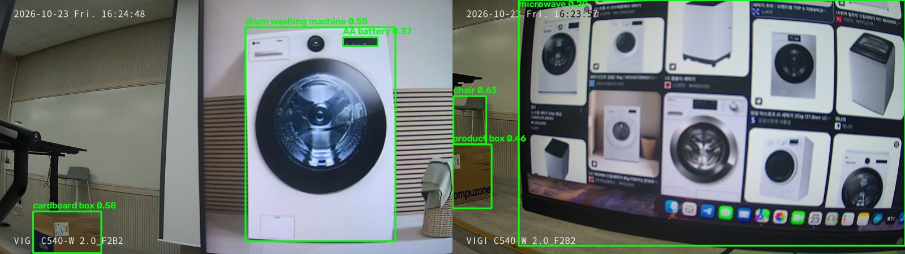
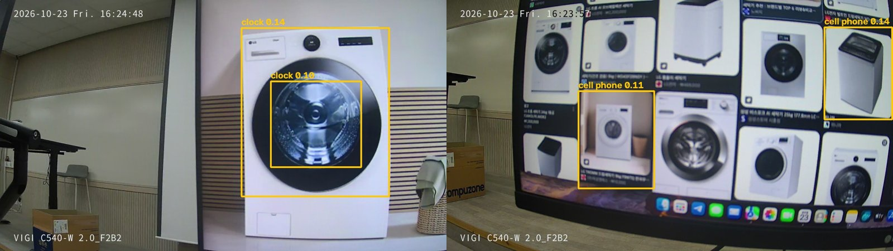
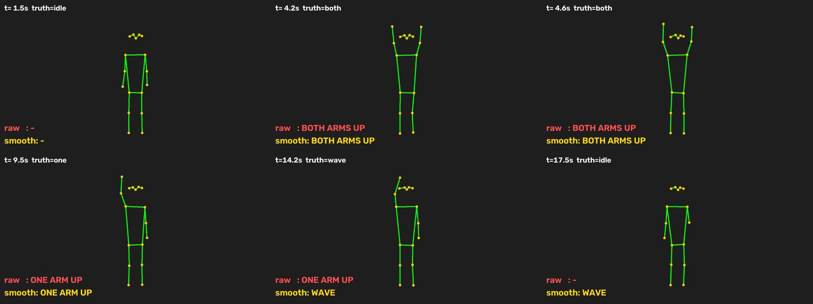
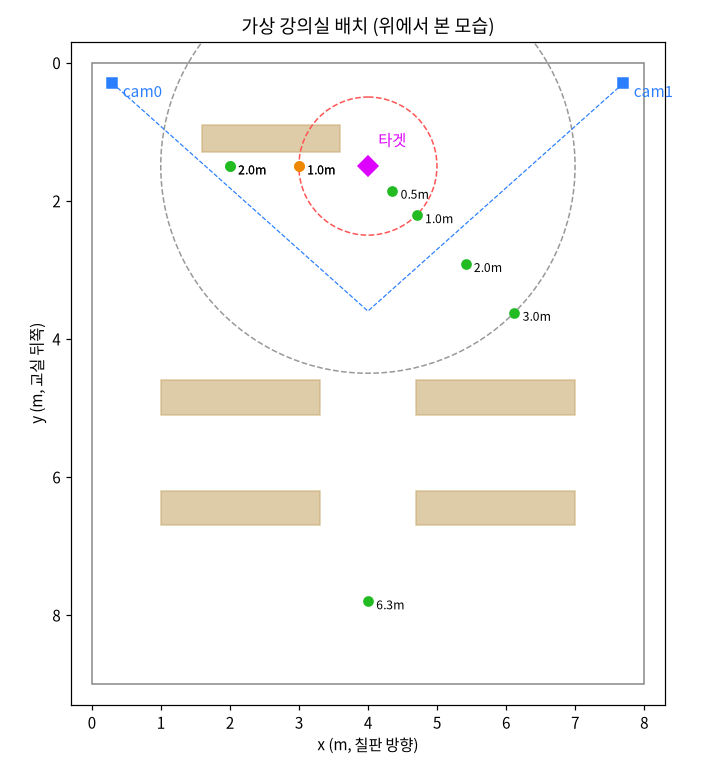

# Jetson 멀티모달 임베딩 실습 결과 보고서 (1~10단계)

- **실습 날짜**: 2026-10-23
- **보드**: Jetson Orin Nano Super
  - JetPack 7.2.1, L4T R39.2.1, CUDA 13.2, Ubuntu 24.04, Python 3.12
  - RAM 7.3GB (CPU와 GPU가 같이 씀)
- **모델**: `google/embeddinggemma-2`
  - 텍스트 270M
  - +비전 440M
  - +오디오 570M
  - 전체 740M
- **카메라**: TP-Link VIGI C540-W
  - 보드 유선랜에 바로 연결해 RTSP로 영상을 받음
  - 안내문의 USB 웹캠 대신 사용
- **같은 보드에서 함께 돌던 것**: 우리 팀 상시 추론 서비스, 팀원 서비스, InfluxDB 2개
  - 이것들이 RAM을 약 2.4~3.8GB 쓰고 있었음

---

## 한눈에 보기

| 단계 | 내용 | 결과 |
|---|---|---|
| 1 | 환경 설정 | MAXN_SUPER, 스왑 8GB, venv `~/eg2`(torch 2.14.1+cu132), GPU bf16 확인 |
| 2 | 패키지·모델 설치 | sentence-transformers 6.2.0, 모델 불러오기 결과 `(768,)` |
| 3 | 텍스트 검색 | 768·256·128차원 모두 **2/2 정답**, 165ms |
| 4 | 영상 검색 | 카메라 장면 사진으로 **1/3 정답(△1)** |
| 5 | 음성 검색 | **2/3 정답**(합성 음성만 오답) |
| 6 | 성능 측정 | 5가지 구성 모두 실측. 전체 모델(740M)도 동작, 최대 RAM 6.4GB |
| 7 | 도메인 미세 조정 | accuracy@1 0.833 → **0.85**, accuracy@3 0.917 → **0.967**. 다만 일반 질의 1개가 나빠짐 |
| 8 | 실시간 물체 검출·검색 | yolo는 세탁기를 clock·cell phone으로 오인식(기본 기준에서는 미검출). relabel은 그 박스를 드럼·통돌이 세탁기로 교정(3/4), 노트북·키보드·모니터 7/7. yoloe만 기본 기준에서 드럼 세탁기·상자 검출(헛검출 2건) |
| 9 | 사람 동작 인식 (합성 관절 데이터) | 시간 안정화로 만세 13→3회(정확), 손 흔들기 별도 검출. 관심도 11/12. GRU는 1차(3명) 낯선 사람 박수 0% → 2차(6명·만세 라벨 추가) 95~100%. 측면(65도)은 여전히 약함 |
| 10 | 특정 물체 접근 감지 (카메라 1대, 가상 강의실) | 안내문 1대 방식은 발목 15~20cm, 어깨 1.2m 가정 1~1.6m 오차. **1대 보완(mono)**으로 서 있는 사람 1~2cm, 알람 5개 시나리오 통과. 이동 카트 충돌 위험 알람 근접보다 약 1초 먼저 |

---

## 1단계 환경 설정

| 항목 | 상태 |
|---|---|
| 저장 장치 | 이미 NVMe로 부팅된 상태라 별도 작업 없음 |
| 전력 모드 | `nvpmodel -m 2`(MAXN_SUPER) + `jetson_clocks` (재부팅하면 `jetson_clocks`는 다시 실행해야 함) |
| 스왑 | `/swapfile` 8GB, `/etc/fstab`에 등록 |
| apt | ffmpeg, libopenblas-dev, espeak-ng |
| 가상환경 | `~/eg2`, `torch 2.14.1+cu132`, `torchvision 0.29.1+cu132` (cu132 인덱스) |
| GPU 확인 | Orin, capability (8, 7), bf16 지원, bf16 행렬곱 1.5 TFLOPS |

## 2단계 패키지·모델 설치

- 설치된 버전: sentence-transformers 6.2.0, transformers 5.20.1
- torch가 PyPI 버전으로 덮어써지지 않도록 `~/eg2/torch-pin.txt`로 고정했습니다.
- `check.py`를 통과했고, `load().encode('test').shape`가 `(768,)`로 나왔습니다.
- 모델 다운로드: 1.5GB, 약 4분

## 3단계 텍스트 검색

| 차원 | 지연 | "졸리고 머리가 맑지 않아요" | "냉방 몇 도?" |
|---|---|---|---|
| 768 | 167 ms | CO2 문장 ✅ (0.717) | 에어컨 문장 ✅ (0.725) |
| 256 | 160 ms | CO2 문장 ✅ (0.734) | 에어컨 문장 ✅ (0.754) |
| 128 | 154 ms | CO2 문장 ✅ (0.785) | 에어컨 문장 ✅ (0.810) |

- **변형 과제**: `prompt_name`(SearchQuery·Document)을 빼고 돌리면 첫 질의가 조도 문장을 1위로 골랐습니다(오답). 질의·문서 프롬프트를 구분하는 것이 결과를 바꿉니다.
- 다만 프롬프트를 써도 첫 질의의 1·2위 점수 차이는 0.007이라, 아슬아슬하게 맞힌 것입니다.

## 4단계 영상 검색

카메라를 들고 30초 동안 교실을 비췄고, 그 영상에서 5초마다 장면 사진 6장을 뽑아 검색했습니다.

| 질의 | 1위 | 판정 |
|---|---|---|
| 사람이 없는 빈 강의실 | 사람 없는 흰 스크린 쪽 | △ 빈 좌석 사진이 더 적절함(3위) |
| 학생들이 앉아 수업을 듣는 모습 | 흰 스크린 | ✗ 정답(사람이 앉은 사진)은 3위 |
| 화이트보드에 쓴 글씨 | 흰 스크린 | ○ |

- 점수 차이가 0.003~0.03으로 작아서, 장면을 뚜렷하게 구분하지 못했습니다.
- 손으로 들고 찍어 사진이 흔들리고 기울어진 것도 원인입니다.

## 5단계 음성 검색

| 질의 \ 파일 | beep | noise | speech |
|---|---|---|---|
| 덥다고 냉방을 요청하는 목소리 | 0.622 | **0.659** ✗ | 0.591 |
| 날카로운 경보음 | **0.702** ✓ | 0.670 | 0.643 |
| 웅웅거리는 배경 소음 | 0.672 | **0.680** ✓ | 0.609 |

- espeak-ng로 만든 합성 음성은 모든 질의에서 점수가 가장 낮았습니다. 기계음이라 "사람 목소리"로 인식되지 않은 것으로 보입니다.
- 카메라 내장 마이크로 녹음하는 기능(`make_audio.py mic`)은 만들어 두었지만, 실제 목소리 비교는 하지 않았습니다.

## 6단계 성능 측정

`bench.py`로 구성마다 프로세스를 따로 띄워 측정했습니다. 측정 기준은 다음과 같습니다.
- **지연**: 같은 입력을 두 번 처리했을 때 **두 번째 값**
- **RAM**: 보드 전체 사용량(tegrastats 기준)
- **GPU**: 두 번째 실행 동안 50ms마다 읽은 사용률의 평균, 괄호 안은 최대값

| 구성 | 로드 크기 | 로드 후 RAM (MB) | 입력 | 지연 (ms) | GPU 사용률 (%) |
|---|---|---|---|---|---|
| 텍스트 전용 | 271M | 3,721 (실행 중 최대 4,250) | 질의 2개 | **165** | 9 (12) |
| +비전 | 439M | 4,052 (+578) | 이미지 5장 (2560×1440) | **2,410** | 84 (100) |
| +비전 | 439M | 4,344 (+611) | 동영상 10초 (1fps, 10프레임) | **2,156** | 85 (100) |
| +오디오 | 577M | 4,707 (+991) | WAV 3개 (16kHz 모노) | **348** | 46 (74) |
| 전체 | 744M | 4,680 (+963), 실행 중 최대 6,419 | 질의 2 + 이미지 5 + 동영상 10초 + WAV 3 | **4,992** | 80 (100) |

- **텍스트는 가볍습니다.** GPU를 거의 쓰지 않고, GPU에 작업을 넘기는 준비 시간이 대부분입니다.
- **이미지·동영상이 가장 무겁습니다.** 1장(1프레임)에 약 0.2~0.5초가 걸리고, GPU를 100%까지 씁니다.
- **첫 실행은 훨씬 느립니다.**
  - 오디오: 3,144ms → 348ms
  - 전체: 8,747ms → 4,992ms
- 텍스트 전용의 "로드 후 RAM"이 로드 전보다 낮게 나온 것(−49MB)은 다른 프로세스의 메모리가 스왑으로 밀려난 탓입니다.

---

## 7단계 도메인 미세 조정

### 데이터

안내문의 "제공 데이터"가 없어서, 안내문 조건대로 직접 만들었습니다(`code/make_data.py`).

| 세트 | 규모 | 주제 |
|---|---|---|
| 학습 `train.jsonl` | 문서 94개 × 질의 3개 = **282쌍** | CO2·환기, 냉난방, 공기질, 센서·네트워크, 경보, 에이전트, 엣지 운영, 과정 운영 |
| 평가 `eval.jsonl` | 문서 20개 × 질의 3개 = **60쌍** | 온도·습도·PM2.5·조도·소음·TVOC·재실 인원·냉난방·환기·센서 관리·경보·에이전트 권한 |

- 학습·평가 세트는 문서와 질의가 하나도 겹치지 않습니다. 생성 스크립트가 이를 자동으로 검사합니다.
- 문서의 수치는 실습용 가상 운영 기준입니다.

### 결과

| 모델 | accuracy@1 | accuracy@3 | ndcg@10 | 학습 시간 |
|---|---|---|---|---|
| 기준 (google/embeddinggemma-2) | 0.833 | 0.917 | 0.918 | - |
| 미세 조정 (eg2-classroom) | **0.850** | **0.967** | **0.933** | 222초 (3 epoch) |

- 학습 설정은 안내문 그대로입니다: 배치 8, accumulation 2, lr 2e-5, MatryoshkaLoss(768/512/256/128).
- loss는 2.376 → 1.34 → 0.76 → 0.88 → 0.71로 줄었습니다.
- epoch별 평가 점수는 1 epoch부터 accuracy@1 0.85로 같았고, 2~3 epoch에는 ndcg@10만 0.930 → 0.933으로 조금 올랐습니다.
- 학습하는 동안 팀원도 같은 보드에서 다른 학습을 돌리고 있었습니다. 그래서 학습 시간은 혼자 쓸 때보다 길게 나왔을 수 있습니다.

### 일반 성능 확인 (3단계 질의 다시 실행)

| 질의 | 기준 모델 | 미세 조정 모델 |
|---|---|---|
| 수업 중에 졸리고 머리가 맑지 않아요 | CO2 문장 ✅ (0.717) | **조도 문장 ✗** (0.510) |
| 여름에 냉방 몇 도로 맞춰야 하나요? | 에어컨 문장 ✅ (0.725) | 에어컨 문장 ✅ (0.609) |

- **도메인 평가는 조금 올랐지만, 학습 범위 밖의 질의 1개는 틀리게 바뀌었습니다.** 안내문이 경고한 과적합 신호입니다.
- 평가 점수가 1 epoch 이후 더 오르지 않았으므로, 다음에는 **1 epoch + learning_rate 1e-5**로 줄여서 일반 성능을 지키는지 확인하는 것이 좋겠습니다.
- 미세 조정 모델은 텍스트 전용(비전·오디오 가중치 없음)이라, `eg2.py`의 `MODEL_ID`는 원본 그대로 두었습니다. 바꾸면 4·5단계 테스트가 동작하지 않습니다.

---

## 8단계 실시간 물체 추출과 웹 검색

### 구성

- **입력**: 안내문은 USB 웹캠이지만, VIGI 카메라의 RTSP를 OpenCV로 받았습니다(`--source stream1`, 2560×1440 → 1280×720으로 축소).
- **지연 방지**: RTSP는 초당 25프레임이 들어와 검출(약 15fps)보다 빠릅니다. 그대로 읽으면 지연이 계속 쌓이므로, **별도 스레드가 최신 프레임만 남기도록** 했습니다(`LatestFrame`).
- **카메라 방향**: 카메라가 거꾸로 달려 있어서 `--flip`(180도 회전) 옵션을 추가했습니다.
- **나머지 코드는 안내문 그대로**입니다: 검출·추적, 크롭 임베딩, 메모리 인덱스, FastAPI(`/`, `/stream`, `/search`, `/recent`), 사람(person) 크롭 제외.
- **맥에서 보는 법**: SSH 터널(`-L 8000:127.0.0.1:8000`)을 열고 `http://localhost:8000`에 접속합니다.

### 물체별 결과 (1차 시험: 실시간으로 손에 들고 보여 줌)

| 물체 | yolo 라벨 | relabel 라벨 (점수) | yoloe 라벨 | 비고 |
|---|---|---|---|---|
| 컵 | **cup** ✅ (1회) | 미검출 | (보여 주지 않음) | 손에 들고 보여 줌 |
| 노트북 | 미검출 | 미검출 | (보여 주지 않음) | 손에 든 물체는 사람과 겹쳐 잘 안 잡힘 |
| 휴대폰 | 미검출 | 미검출 | (보여 주지 않음) | 〃 |
| 드럼 세탁기 (휴대폰 화면 사진) | 미검출 | 미검출 | (보여 주지 않음) | 〃 |
| 카메라 제품 상자 (전지 포장 대신) | **tv** ❌ 오인식 | **모니터** ❌ (0.63~0.66) | 미검출 | 상자가 화면을 가득 채울 만큼 가까울 때는 어느 모드도 못 잡음 |
| 건전지 | 준비 못 함 | | | |
| 모니터 뒷면 | tv | **모니터** ✅ (0.70~0.71) | (잡히지 않음) | |
| 의자 | chair | **의자** ✅ (0.66~0.71) | chair ✅ | |

**추가로 확인한 YOLO의 오인식**
- 카메라가 거꾸로였을 때(뒤집기 적용 전), 모니터 뒷면이 **cat 5회, dog 1회, suitcase 1회**로 잡혔습니다. COCO 80종 중 하나를 반드시 고르는 YOLO의 한계를 그대로 보여 줍니다.

**relabel의 한계**
- 라벨 목록(LABELS)에 "상자"가 없어서, 카메라 상자가 가장 비슷한 "모니터"로 다시 붙었습니다.
- 모든 크롭의 라벨 점수가 0.63~0.71로 높아서, 안내문의 `LABEL_MIN 0.20`은 사실상 아무것도 거르지 못합니다. 이 카메라·조명에서는 **0.66 정도**가 맞는 라벨과 틀린 라벨의 경계였습니다.
- 그래서 `EXTRA_LABELS=1` 옵션으로 "product box / 제품 상자", "cardboard box / 종이 상자" 라벨을 추가할 수 있게 했습니다. 다만 다시 실행했을 때는 상자가 너무 가까워 YOLO 박스가 생기지 않아, 효과는 확인하지 못했습니다.

### 모드별 속도·메모리

| 모드 | 검출 fps | 임베딩 ms/개 | RAM (MB) |
|---|---|---|---|
| yolo | 14.6~16.3 | 602~753 | 프로세스 1,600~1,900 (보드 전체값은 실수로 두 프로세스가 겹쳐 떠 있어 기록하지 않음) |
| relabel | 15.2~15.5 | 602~624 | 프로세스 3,864 / 보드 전체 5,618 |
| yoloe | 7.8(시작 직후) → 14.3(안정 후) | 607~756 | 프로세스 4,037 / 보드 전체 5,800 |

- 앱 하나가 보드 RAM을 약 3GB 더 씁니다(앱을 끄면 보드 전체 2.4~2.8GB).
- 프로세스 RSS 값은 GPU 메모리 매핑이 섞여 들쭉날쭉하므로, 보드 전체값을 기준으로 보는 것이 맞습니다.

### 같은 사진으로 세 모드 다시 비교 (2차 시험)

실시간으로 같은 물체를 세 번 보여 주면 위치·조명이 매번 달라집니다. 그래서 카메라 사진을 저장해 두고, **세 모드에 똑같은 사진을 넣어** 다시 비교했습니다(`code/compare_photos.py`).

**사용한 사진**

| 사진 | 내용 |
|---|---|
| 드럼 세탁기 1대 | 노트북 화면에 세탁기 사진을 크게 띄움. 왼쪽 아래에 종이 상자 |
| 세탁기 여러 대 | 노트북 화면에 세탁기 검색 결과(드럼·통돌이 여러 대). 왼쪽에 의자와 종이 상자 |
| 노트북·키보드·모니터 크롭 5장 | 실시간 yolo 앱이 잘라 저장해 둔 물체 사진 |

- 크롭 5장은 실시간 yolo가 전체 화면에서 **laptop, keyboard, tv로 맞게 검출한 것**입니다.
- 그다음 relabel이 다시 라벨을 붙였습니다.
- yolo·yoloe 열의 크롭 결과는 크롭 사진만 넣고 다시 검출해 본 값입니다. 물체만 확대된 사진이라 박스가 잘 안 잡히는 것이 정상입니다.

| 사진 | yolo (conf 0.5) | relabel (conf 0.35 + 재라벨) | yoloe (conf 0.25) |
|---|---|---|---|
| 드럼 세탁기 1대 | 박스 없음 ❌ | 박스 없음 ❌ | **드럼 세탁기 0.55** ✅, **종이 상자 0.58** ✅, 건전지 0.37 ❌ (세탁기 표시창) |
| 세탁기 여러 대 | 박스 없음 ❌ | 박스 없음 ❌ | **제품 상자 0.46** ✅, 의자 0.63 ✅, 화면 전체를 전자레인지 0.29 ❌. 세탁기 하나하나는 못 잡음 |
| 노트북(닫힘) | 실시간 laptop ✅ / 크롭 재검출 car 0.53 ❌ | **노트북 0.705** ✅ | laptop 0.60 ✅ |
| 노트북(열림) | 실시간 laptop ✅ / 크롭 재검출 없음 | **노트북 0.729** ✅ | 박스 없음 |
| 키보드 | 실시간 keyboard ✅ / 크롭 재검출 없음 | **키보드 0.726** ✅ | 박스 없음 |
| 모니터 앞면 | 실시간 tv / 크롭 재검출 없음 | **모니터 0.685** ✅ | laptop 0.54 ❌ |
| 모니터 뒷면 | 실시간 tv / 크롭 재검출 없음 | **모니터 0.729** ✅ | 박스 없음 |

*yoloe 결과. 왼쪽: 드럼 세탁기와 종이 상자를 찾았지만, 세탁기 표시창을 "건전지"로 잘못 잡았습니다. 오른쪽: 종이 상자와 의자는 찾았지만, 화면 전체를 "전자레인지"로 잡았습니다.*

**검출 기준을 0.1로 낮춰 세탁기 사진 다시 보기 (yolo·relabel)**

기본 기준(yolo 0.5, relabel 0.35)에서는 세탁기에 박스가 생기지 않았습니다. 그래서 기준을 0.1로 낮춰, YOLO가 약하게 본 것까지 꺼내 다시 확인했습니다. 실행 명령은 `CONF=0.1 python compare_photos.py yolo|relabel`입니다.

| 사진 / 박스 위치 | yolo 라벨 | relabel 라벨 (점수) | 판정 |
|---|---|---|---|
| 드럼 세탁기 1대 / 세탁기 몸통 | **clock** 0.14 | **드럼 세탁기** (0.687) | yolo ❌ → relabel ✅ |
| 드럼 세탁기 1대 / 세탁기 문 유리만 | **clock** 0.10 | 물병 (0.654) | 둘 다 ❌ (둥근 유리만 보여 판단이 어려움) |
| 세탁기 여러 대 / 오른쪽 위 통돌이 | **cell phone** 0.14 | **통돌이 세탁기** (0.775) | yolo ❌ → relabel ✅ (종류까지 맞힘) |
| 세탁기 여러 대 / 가운데 왼쪽 드럼 | **cell phone** 0.11 | **드럼 세탁기** (0.706) | yolo ❌ → relabel ✅ |

*기준 0.1에서 relabel 결과. 박스 위 글자는 YOLO의 원래 라벨(clock, cell phone)입니다. relabel은 이 박스들을 드럼 세탁기, 통돌이 세탁기로 다시 붙였습니다.*

- **안내문이 말한 문제를 그대로 확인했습니다.**
  - 세탁기는 YOLO가 학습한 80종에 없습니다.
  - 그래서 YOLO는 아주 낮은 신뢰도(0.10~0.14)로 **clock, cell phone처럼 엉뚱한 클래스를 고릅니다.**
  - 기본 기준(0.5)에서는 그마저 버려져 "박스 없음"이 됩니다.
- **relabel은 같은 박스 4개 중 3개를 바로잡았습니다.** 드럼 세탁기와 통돌이 세탁기도 구분했습니다.
- **한계도 함께 보였습니다.**
  - 세탁기 문 유리처럼 물체의 일부만 잘린 박스는 relabel도 틀립니다.
  - 기준을 0.1까지 낮추면 이런 불완전한 박스도 같이 늘어납니다.
  - 그래서 실제 서비스에서는 **박스를 잘 잡는 yoloe와 relabel을 함께 쓰는 쪽**이 낫습니다.

**relabel의 1·2위 후보 점수 차이**

| 크롭 | 1위 | 2위 | 차이 |
|---|---|---|---|
| 키보드 | 키보드 0.726 | 노트북 0.682 | 0.044 |
| 노트북(닫힘) | 노트북 0.705 | 모니터 0.620 | 0.085 |
| 노트북(열림) | 노트북 0.729 | 모니터 0.668 | 0.061 |
| 모니터 뒷면 | 모니터 0.729 | 노트북 0.669 | 0.060 |
| 모니터 앞면 | 모니터 0.685 | 노트북 0.634 | 0.051 |

- 다섯 개 모두 맞혔지만, 1·2위 점수 차이가 0.04~0.09로 크지 않습니다.
- 모니터·노트북·키보드처럼 생김새가 비슷한 물체끼리 점수가 가깝습니다.

### 정리

- **yolo(기준선)**
  - 학습한 80종 안의 물체(노트북, 키보드)는 실시간 화면에서 맞게 잡았습니다.
  - 80종 밖의 물체는 **박스조차 안 생기거나**(세탁기, 종이 상자), **엉뚱한 클래스로 표시**했습니다(카메라 상자 → tv, 모니터 뒷면 → cat).
- **relabel(개선 1)**
  - YOLO가 박스를 잡은 물체는 **7개 중 7개 모두 강의실 용어로 맞게** 다시 붙였습니다. 모니터·의자·노트북·키보드가 그 예이고, tv를 "모니터"로 바로잡은 것도 포함됩니다.
  - 속도도 yolo와 같았습니다(약 15fps).
  - 다만 **YOLO가 박스를 못 잡은 물체는 고칠 수 없습니다.** 기본 기준(0.35)에서는 세탁기·상자에 박스가 생기지 않았습니다.
  - 기준을 0.1로 낮추면 YOLO가 세탁기를 clock·cell phone으로 약하게 잡습니다. 그 박스 4개 중 3개를 relabel이 **드럼 세탁기·통돌이 세탁기로 바로잡았습니다.**
  - 라벨 목록에 없는 물체는 가장 비슷한 라벨로 잘못 붙습니다(라벨 목록에 상자를 넣기 전에는 카메라 상자 → 모니터).
- **yoloe(개선 2)**
  - **세 모드 중 유일하게 드럼 세탁기와 상자를 찾았습니다.**
  - 대신 conf 0.25에서는 헛검출이 있었습니다(표시창 → 건전지, 화면 → 전자레인지).
  - 시작 직후에는 속도가 절반(7.8fps)이었다가, 안정된 뒤 14fps가 되었습니다.
- **강의실 서비스에 쓴다면**
  - **yoloe로 박스를 찾고, 그 박스에 relabel로 라벨을 붙이는 조합**을 권합니다(안내문의 확장 과제).
  - yoloe는 낯선 물체의 박스를 잡고, relabel은 잡힌 박스의 라벨을 정확하게 고치기 때문입니다.
  - 헛검출을 줄이려면 yoloe의 conf를 0.35 정도로 올리는 것이 좋겠습니다. 이번 결과의 헛검출(0.29, 0.37)이 대부분 이 값 아래에 있었습니다.

---

## 9단계 사람 동작 인식 (만세·한팔들기·손 흔들기·악수, 관심도, GRU 학습)

### 실험 방법: 합성 관절 데이터

사람을 직접 촬영하지 않고, **YOLO11n-pose가 영상에서 뽑아 줄 관절 좌표(17개)를 직접 만들어** 판정 로직에 넣었습니다(`code/pose/pose_sim.py`).

**합성 데이터의 설정**
- 화면 1280×720, 초당 15프레임 (8단계에서 이 보드 검출 속도가 약 15fps였습니다)
- 실제 검출 결과처럼 보이도록 아래 요소를 넣었습니다.
  - 체격: 어깨 너비 55~120px
  - 몸 방향·머리 방향
  - 관절 흔들림 1.5~2.5px (팔은 1.7배 더 흔들림)
  - 손목이 잠깐 안 잡히는 프레임 3%
  - 팔을 올리고 내리는 0.4초 전환
  - 측면일 때 먼 팔이 60% 확률로 가려짐
- 동작 종류: 기본, 만세, 한팔들기, 손 흔들기, 악수(2명), 박수, 팔짱, 지나감, 힐끗 봄, 관심 있음, 머무름

**판정 코드**
- 판정은 `pose_app.py`의 코드를 **그대로** 씁니다.
  - 원래 카메라 루프 안에 있던 프레임 처리 부분을 `step()` 함수로 빼기만 했습니다.
  - 그래서 카메라 영상과 합성 데이터가 같은 코드를 지납니다.
- 학습은 `train_pose.py`를 안내문 그대로 썼습니다.

> ⚠️ **이 실험이 확인한 것과 못 한 것**
> - 확인한 것: 판정 규칙, 시간 안정화, 행동 패턴, GRU 학습 로직이 의도대로 동작하는지
> - 못 한 것: **"영상에서 관절을 찾는 단계(YOLO-pose)"는 시험하지 않았습니다.**
> - 실제 사람 영상에서는 관절 검출이 더 흔들리고 빠지므로, 정확도는 이 결과보다 낮게 나올 것입니다.

*합성 뼈대 영상(`figs/pose_합성영상.mp4`, 20초)의 장면들입니다.*
- 빨간 글자는 프레임 단위 판정(raw), 노란 글자는 0.6초 안정화(smooth) 결과입니다.
- 손 흔들기를 raw는 "ONE ARM UP"으로만 보고, smooth는 "WAVE"로 따로 잡습니다.
- 마지막 장면은 흔들기를 멈춘 지 0.5초 뒤인데, 안정화 지연 때문에 아직 WAVE로 남아 있습니다.

### 9-4 결과 비교 (9-1 raw vs 9-2 smooth)

| 동작 (실제 횟수) | 9-1 raw 카운트 | 9-2 smooth 카운트 | 비고 |
|---|---|---|---|
| 만세 (3회) | 만세 8, 한팔들기 5 | **만세 3** ✅ | raw는 팔을 올리는 순간과 손목이 잠깐 가려지는 프레임마다 깜빡임 |
| 한팔들기 (3회) | 한팔들기 4 | **한팔들기 3** ✅ | |
| 손흔들기 (3회) | 한팔들기 4 | 한팔들기 3, **손흔들기 3** ✅ | raw는 흔드는 손과 든 손을 구분 못 함. smooth는 처음 1.5초는 한팔들기로 보다가 손흔들기로 바뀜 |
| 측면에서 만세 (3회) | 한팔들기 34, 만세 33 | 만세 5, 손흔들기 5, 한팔들기 1 ❌ | 측면이라 어깨 너비가 40px로 줄고 먼 팔이 자주 가려짐. 두 손목 중 위에 있는 쪽이 바뀌면서 x가 튀어 **손 흔들기로 헛검출** |
| 악수 (3회) | 악수 3 | 악수 3 | 합성 데이터에서는 손이 일정하게 다가가서 raw도 깜빡이지 않음 |

- **시간 정보(0.6초 다수결 + 1.5초 손목 좌우 움직임)만으로 깜빡임이 사라지고 손 흔들기가 따로 잡혔습니다.**
- 다만 안내문이 말한 "남는 한계"가 그대로 나왔습니다. **측면에서는 어깨 너비가 줄어 기준이 흔들리고 팔이 가려지면서**, 안정화한 뒤에도 헛검출이 남았습니다.

### 9-5 행동 패턴 (관심도)

| 시나리오 (3회씩) | 기대 패턴 | 맞은 횟수 | 틀린 경우 나온 패턴 |
|---|---|---|---|
| 그냥 지나감 | 지나감 | **3/3** | |
| 걸으며 2초 봄 | 힐끗 봄 | **3/3** | |
| 멈춰서 5초 봄 | 관심 있음 | **3/3** | |
| 옆을 보며 15초 서 있음 | 머무름 | **2/3** | 지나감 |

- 틀린 1건은 **멀리 있고(어깨 80px) 비스듬히 선(몸 방향 60도) 사람**이었습니다.
- 화면상 어깨 너비가 40px밖에 안 되어, 서 있는데도 관절 흔들림 1.5px가 "초당 어깨 너비 0.5배 이상 이동"(MOVE_TH)으로 계산됐습니다.
- 안내문이 말한 "정해 둔 기준값은 현장에서 자주 어긋난다"는 한계입니다.

### 9-3 학습 데이터 수집과 9-6 GRU 학습

| 차수 | 동작 녹화 | 행동 녹화 | 검증 정확도 (같은 녹화 뒷부분) |
|---|---|---|---|
| 1차 | idle, wave, clap, arms_crossed × **3명**(몸 방향 −20~+15도) × 35초 | passing, glance, interested × 12회 왕복 | 동작 1.000, 행동 1.000 |
| 2차 | 위 4개 + **arms_up(만세)** × **6명**(몸 방향 −35~+35도, 어깨 60~122px) × 35초 | 1차와 같음 | 동작 1.000, 행동 1.000 |

**학습에 없던 "낯선 사람" 2명으로 평가**
- 사람 1: 멀리(어깨 62px) 비스듬히(35도) 서서 천천히 작게 흔듦
- 사람 2: 가까이(118px) 반대쪽으로 비스듬히(−28도) 섬
- 표의 값은 동작 시작 1초 뒤부터 화면 라벨이 맞은 프레임 비율이며, 두 사람의 값을 "/"로 나눠 적었습니다.

| 비교 항목 | 규칙 (9-2/9-5) | 학습 모델 1차 | 학습 모델 2차 |
|---|---|---|---|
| 손흔들기 | 99% / 100% | 100% / 100% | 100% / 100% |
| 정면 만세 | 100% / 100% | **12% / 0%** ❌ | **100% / 100%** |
| 측면에서 만세 (65도) | 26% | 26% | 26% |
| 박수 (규칙 없음) | 불가 | **0% / 0%** ❌ | **100% / 95%** |
| 팔짱 (규칙 없음) | 불가 | 0% / 68% | **95% / 100%** |
| 지나감·힐끗 봄·관심 있음 (3×3) | 9/9 | 8/9 | **9/9** |

**배운 점**
- **같은 녹화의 뒷부분으로 잰 검증 정확도(100%)는 믿을 수 없습니다.**
  - 1차 모델은 검증 100%였지만, 낯선 사람의 박수를 전부 "기본"으로 보았습니다.
  - 정면 만세는 "clap"으로 보았습니다.
  - 안내문의 "낯선 사람으로 평가하라"가 왜 필요한지 그대로 확인했습니다.
- **모델이 모르는 동작은 규칙 결과까지 덮어씁니다.**
  - 1차 모델에는 만세 라벨이 없었습니다. 그래서 만세를 가장 비슷한 clap으로 확률 0.7 이상 확신했고, 규칙이 맞힌 만세를 지워 버렸습니다(100% → 12%/0%).
  - 학습 모델을 쓸 때는 **화면에 나올 수 있는 동작을 모두 라벨로 넣거나**, 규칙이 확실한 동작은 모델이 덮어쓰지 않게 해야 합니다.
- **모델을 키우지 않고 데이터만 늘려서 해결했습니다.**
  - 2차에서는 모델 구조를 그대로 두고, 사람(3→6명)·각도·거리만 다양하게 녹화했습니다.
  - 그 결과 박수 0% → 95~100%, 팔짱 → 95~100%, 만세 → 100%가 되었습니다.
  - 안내문의 "데이터를 늘리는 것이 모델을 키우는 것보다 효과가 크다"를 확인했습니다.
  - 다만 2차 학습 범위(±35도, 60~122px)가 낯선 두 사람의 범위를 덮도록 녹화했으므로, 그보다 더 다른 사람에 대한 성능은 따로 확인해야 합니다.
- **학습 범위 밖은 여전히 안 됩니다.**
  - 측면 만세(65도)는 학습한 각도 범위(±35도) 밖이라, 모델이 확신하지 못해 규칙 결과가 그대로 쓰였습니다(26%).
  - 측면 동작을 잡으려면 측면 녹화를 넣어야 합니다.
- **안내문 코드에서 발견한 점**
  - 행동 모델의 라벨(passing·glance·interested)은 영어입니다. 그런데 사람별 최종 패턴을 고르는 순위표(BEH_RANK)는 한글 키만 알고 있습니다.
  - 그래서 모델 판정은 "지나감"과 같은 최하 순위로 취급되고, 사람 요약에는 규칙 판정이 주로 남습니다.
  - 학습 모델의 행동 결과를 요약에 제대로 반영하려면 라벨을 한글로 맞추거나 순위표에 영어 라벨을 추가해야 합니다.

### 9단계 정리

- **규칙**
  - 정면에서는 시간 정보만으로 충분히 정확했습니다.
  - 만세·한팔들기·손 흔들기·악수, 관심도 4가지 중 3가지는 3/3을 맞혔습니다.
  - 하지만 측면·원거리에서 기준값이 흔들립니다.
- **학습 모델**
  - 규칙으로 적기 어려운 박수·팔짱을 추가할 수 있었습니다.
  - 다만 **녹화한 사람·각도 범위 안에서만** 동작합니다.
- **실제로 쓸 때의 순서**
  1. 정면 동작은 규칙으로 시작합니다.
  2. 필요한 새 동작만 여러 사람·각도로 녹화해 모델에 넣습니다.
  3. 반드시 학습에 참여하지 않은 사람으로 확인합니다.
- **다음에 할 일**
  - 실제 VIGI 카메라로 YOLO-pose를 돌려 관절 검출 단계까지 포함해 같은 표를 다시 채워야 합니다.
  - 코드는 `--source stream1`로 바로 실행할 수 있게 해 두었습니다.

---

## 10단계 특정 물체 접근 감지 (카메라 1대로 할 수 있는 것만)

### 범위

안내문은 USB 카메라 2대로 어깨 중심을 삼각측량하는 것이 핵심입니다. 하지만 **우리는 카메라가 1대뿐**이라, **1대로 할 수 있는 단계만** 했습니다.

| 단계 | 진행 |
|---|---|
| 10-1 렌즈 보정 | ✅ (가상) |
| 10-2 카메라 위치 보정 | ✅ cam0만 (가상). 두 카메라 3D 검증은 못 함 |
| 10-3 ankle1 (1대 + 발목) | ✅ |
| 10-4 stereo (2대 삼각측량) | ❌ 카메라 2대가 필요해 하지 않음 |
| 10-5 한 카메라 추정 | ✅ 안내문 방식(어깨 높이 1.2m 가정) + **1대 보완 방식(mono) 추가** |
| 10-6 접근 알람 | ✅ 자세(앉음/섬) 판정은 높이를 재야 해서 제외 |
| 10-8 이동 타겟 | ✅ 카트도 1대로 추정 |

**실험 방법**
- 사람이 서 있을 테이프 지점과 체커보드가 없어서, 9단계처럼 **가상 강의실**에서 시험했습니다(`code/prox/prox_sim.py`).
- **가상 강의실과 카메라**
  - 강의실은 8m × 9m, 타겟(소화기)은 칠판 앞 (4.0, 1.5)입니다.
  - 카메라 cam0은 왼쪽 앞 모서리 높이 2.4m에 두었습니다(640×480, 렌즈 왜곡 있음).
- **보정은 실제 절차를 흉내 냈습니다.**
  - 10-1: 체커보드 20장, 코너 오차 0.25px로 `calibrateCamera`
  - 10-2: 기준점 클릭 오차 1px, 줄자 오차 1cm로 `solvePnP` (`calib_extrinsics.py`와 같은 계산)
- **사람**
  - 3D 관절을 카메라 화면에 투영하고, 관절 오차 **2px**를 넣었습니다(안내문 시뮬레이션과 같은 조건). 어깨 높이는 1.38~1.49m입니다.
  - 책상(0.74m)에 가려진 관절은 신뢰도가 낮아집니다.
  - 가려진 발목은 **35% 확률로 가장 가까운 책상 다리를 발목으로 잘못 잡게** 했습니다(안내문이 말한 문제).
- **판정 코드**
  - `stereo.py`는 안내문 그대로입니다(1대 보완용 함수 `height_on_vertical` 하나만 추가).
  - `proximity_app.py`도 그대로 쓰되, 프레임 처리를 `process_frame()`, 이동 타겟 갱신을 `target_apply()`로 나누기만 했습니다.
  - 고정 타겟 위치는 안내문 10-3과 같이 `--target-xy`로 직접 주었습니다. YOLOE + EmbeddingGemma로 타겟을 자동으로 찾는 부분은 시험하지 않았습니다.

*가상 강의실을 위에서 본 모습입니다. 초록 점은 서 있는 측정 지점, 주황 점은 앉는 지점, 빨간 원은 근접 기준 1m, 회색 원은 이탈 기준 3m입니다. 이 실험은 cam0만 썼습니다.*

### 10-1, 10-2 보정 (cam0)

| 항목 | 목표 | 결과 |
|---|---|---|
| 렌즈 보정 재투영 RMS | 0.5px 이하 | **0.345px** ✅ |
| 위치 보정 평균 재투영 오차 | 3px 이하 | **0.92px** ✅ |
| 계산 위치 vs 실제 위치 | 20cm 이내 | **1.5cm** ✅ |

- 검증점 3D 오차(C1 3.6cm, C2 5.0cm)는 가상 cam1까지 써서 계산한 값이라 참고로만 적습니다.

### 1대 보완 방식(mono)을 추가한 이유

안내문의 1대 방식 두 가지를 먼저 돌려 보니 둘 다 쓰기 어려웠습니다.
- **ankle1**
  - 발목은 바닥보다 약 8cm 위에 있는데, z=0(바닥)으로 계산해서 항상 15~20cm 멀게 잽니다.
  - 책상에 가려지면 책상 다리를 발목으로 잡습니다.
- **어깨 1.2m 가정**(안내문 10-5의 한 카메라 추정)
  - 실제 어깨 높이(1.38~1.49m)와 0.2~0.3m만 달라도 **거리가 1~1.6m 멀게** 나왔습니다.
  - 안내문도 "0.6~1.2m 빗나갔다"고 했던 문제입니다.

그래서 **카메라 1대로 할 수 있는 보완 방식(`--mode mono`)**을 추가했습니다.
1. 발목이 보이면 발목(높이 8cm) → 바닥 위치를 구하고, **같은 순간 그 사람의 어깨 높이를 재서 기억**합니다.
2. 발목이 가려지면(책상 등) **기억해 둔 그 사람의 어깨 높이**로 어깨 시선을 평면에 내립니다.
3. 기억이 없으면 안내문처럼 1.2m로 가정합니다.
4. **가짜 발목 거르기**: 발목으로 잰 어깨 높이가 사람 범위(0.8~1.8m) 밖이거나, 그동안 보인 높이와 15cm 넘게 다르면 책상 다리로 보고 버립니다.

### 10-7 결과 비교 (같은 지점, 타겟까지 화면 거리)

값은 3명(어깨 1.38/1.43/1.49m)의 중앙값이고, 괄호 안은 평균 오차입니다(단위 m).

| 실제 거리·자세 | ankle1 (10-3) | 어깨 1.2m 가정 (10-5) | **mono (1대 보완)** |
|---|---|---|---|
| 0.5m, 서 있음 | 0.64 (0.14) | 1.53 (1.05) | **0.50 (0.01)** |
| 1.0m, 서 있음 | 1.15 (0.15) | 2.14 (1.16) | **1.00 (0.01)** |
| 2.0m, 서 있음 | 2.19 (0.19) | 3.37 (1.39) | **2.00 (0.02)** |
| 3.0m, 서 있음 | 3.22 (0.22) | 4.61 (1.62) | **2.99 (0.02)** |
| 1.0m, 처음부터 책상에 앉아 있음 | 0.72 (0.28) ※책상 다리 | 1.31 (0.30) | 0.80 (0.20) |
| 2.0m, 처음부터 책상 뒤에 서 있음 | 2.47 (0.47) ※책상 다리 | 1.63 (0.38) | 1.63 (0.41) |
| **2.0m, 걸어와서 책상 뒤에 섬** | 2.47 (0.34) ※책상 다리 | 1.63 (0.38) | **2.02 (0.03)** |
| 1.0m, 걸어와서 책상에 앉음 | 0.72 (0.28) ※책상 다리 | 1.29 (0.27) | 0.81 (0.20) |
| 6.3m, 서 있음 (카메라에서 멂) | 4.73 (1.55) | 7.71 (1.40) | 4.53 (1.71) |

**보이는 것**
- **발목이 보이면 mono는 1~2cm로 정확합니다.**
  - ankle1의 15~20cm 오차는 대부분 "발목 높이 8cm" 때문이었습니다.
- **걸어 들어와서 책상 뒤에 서면 mono의 효과가 가장 큽니다**(0.34m → 0.03m).
  - 걸어오는 동안 잰 어깨 높이를 책상 뒤에서도 그대로 씁니다.
- **mono로도 해결되지 않는 경우**
  - **처음부터** 앉아 있거나 책상 뒤에 있는 사람은 키를 잴 기회가 없어서 안내문 방식과 같습니다(0.2~0.4m).
  - **서 있다가 앉으면**, 서 있을 때 잰 어깨 높이(약 1.43m)를 앉은 사람(약 1.05m)에 그대로 써서 0.2m 빗나갑니다.
  - **카메라에서 먼 곳(6.3m)**은 앞쪽 책상 줄에 발이 가려지고 각도도 얕아서, 세 방식 모두 1.4m 넘게 틀렸습니다.
- ※ 표시는 발목이 아니라 **책상 다리**를 잡은 값입니다. 타겟 바로 옆 책상이라 우연히 비슷하게 나왔을 뿐입니다.

### 10-6 접근 알람 (근접 1.0m, 이탈 3.0m)

| 시나리오 (3회씩) | 기대 결과 | ankle1 | 어깨 1.2m 가정 | **mono** |
|---|---|---|---|---|
| 4m에서 타겟으로 걸어옴 | 근접 알람 1회 | 3/3 | **0/3** (멀게 재서 1m 안에 못 들어옴) | **3/3** |
| 타겟 앞 0.5m에서 4m 밖으로 나감 | 이탈 알람 | 3/3 | 3/3 | **3/3** |
| 1.0m 경계에서 10초 서 있음 | 알람 1회만 (깜빡임 없음) | 알람 0회 (15cm 멀게 잼) | 알람 0회 | **정확히 1회씩** ✅ |
| 타겟 2m 옆을 지나감 | 근접 알람 없음 | 3/3 | 3/3 | **3/3** |
| 타겟 옆 책상에 앉음 (0.8m) | 근접 알람 | 3/3 (책상 다리로 우연히) | 1/3 | 3/3, 단 **알람 2~3번 반복** |

- **mono는 5개 시나리오를 모두 통과했습니다.**
  - 1.0m 경계에서는 히스테리시스(0.2m) 덕분에 알람이 딱 한 번만 울렸습니다.
- 남은 문제: 책상에 앉은 경우 mono의 알람이 2~3번 반복됐습니다.
  - 가짜 발목을 버리는 순간과 어깨 추정으로 넘어가는 순간 사이에서 위치가 튀기 때문입니다.
- **안내문 코드에서 발견한 점**
  - "접근 시작" 이벤트는 **이탈 기준(3m) 안에서 접근이 시작될 때만** 나옵니다.
  - 4m에서 걸어오면 3m를 넘을 때 이미 "접근 중" 상태라서, 세 방식 모두 **한 번도 나오지 않았습니다.**
  - 3m 경계를 넘는 순간에도 이벤트를 내려면 조건을 바꿔야 합니다.
- **자세(앉음/섬)**는 어깨 높이를 직접 재야 해서 1대로는 판정할 수 없습니다.

### 10-8 이동 타겟 (카트, 사람은 제자리, 1대·약 7fps)

| 카트 속도 | 충돌 위험 알람 때 실제 거리 | 근접 알람보다 먼저 울린 시간 | 추정 속도 | 멈춘 뒤 거리 과소 추정 | 비고 |
|---|---|---|---|---|---|
| 천천히 (0.5m/s) | 1.0m | 0초 (근접 알람과 동시) | 0.54m/s | 0.12m | 접근 속도 기준(0.5m/s) 근처라 늦게 울림 |
| 보통 (1.0m/s) | **2.14m** | **1.14초 먼저** | 1.12m/s | 0.28m | |
| 빠르게 (1.5m/s) | **2.29m** | **1.0초 먼저** | 1.47m/s | 0.35m | |
| 카메라에서 2.5초 가려짐 (1.0m/s) | 1.43m | 0.43초 먼저 | 1.58m/s | 0.32m | 예측 17프레임, 놓침 5프레임, "다시 찾음" 1회 |

- **보통 속도(1.0m/s)에서 충돌 위험 알람이 2.1m 지점, 근접 알람보다 약 1.1초 먼저** 울렸습니다.
  - 안내문 2대 시뮬레이션(1.2m/s에서 2.2m, 약 1초 먼저)과 비슷합니다.
  - 카트처럼 높이가 일정한 물체는 1대로도 위치를 꽤 잘 추정합니다.
- **카트가 갑자기 멈추면** 칼만 필터가 멈춤을 늦게 반영해, 거리를 0.12~0.35m 짧게 잡았습니다.
  - 빠를수록 더 크게 틀렸고, 안내문 결과(약 20cm)보다 조금 큽니다.
- **카트가 출발할 때 마침 가려지면** 필터는 카트를 "멈춰 있다"고 예측합니다.
  - 다시 보였을 때 위치가 크게 튀면서 속도를 1.58m/s로 과대 추정했고, 알람은 0.43초 먼저 울리는 데 그쳤습니다.
- 다시 찾을 때의 임베딩 재식별은 시험하지 않았습니다. 다시 보였을 때 **맞는 카트를 고른다고 가정**했습니다.

### 10단계 정리

- **카메라 1대로도 접근 알람은 쓸 만하게 만들 수 있었습니다.**
  - 그 열쇠는 "어깨 높이를 1.2m로 가정하지 않고, 발이 보일 때 그 사람의 키를 재 두는 것"이었습니다(mono).
  - 서 있는 사람은 1~2cm, 걸어와 책상 뒤에 선 사람은 3cm 오차로 잡았고, 알람 시나리오 5개를 모두 통과했습니다.
- **1대로는 넘을 수 없는 한계**
  - 처음부터 가려져 있는 사람, 서 있다가 앉는 사람, 카메라에서 먼 사람은 수십 cm~1.7m 빗나갑니다.
  - 앉음/섬 판정도 안 됩니다.
  - 안내문이 2대 삼각측량을 쓰는 이유가 바로 이것입니다.
- **실제로 할 때**
  1. VIGI 카메라로 10-1(체커보드)과 10-2(기준점 테이프)를 먼저 합니다.
  2. 그다음 `python proximity_app.py --mode mono --target-xy 4.0,1.5`로 같은 표를 채웁니다.
  - 지금 코드는 USB 웹캠용이라 RTSP 입력은 8·9단계처럼 바꿔야 합니다.

---

## 안내문과 다르게 처리한 부분 (이 보드에서만 생긴 문제)

| 문제 | 해결 |
|---|---|
| 고정 파일에 torchaudio가 빠져 있어 CUDA 13.0용이 설치됨. torch(13.2)와 맞지 않아 transformers까지 import 실패 | Jetson용 cu132 torchaudio가 없어 **제거**. 오디오는 librosa·soundfile로 읽음 |
| torchcodec이 보드 ffmpeg와 맞지 않음(`libswscale.so.9` 없음). `{"video": 경로}`, `{"audio": 경로}` 모두 실패 | **torchcodec 제거**. 동영상은 PyAV로 1초마다 프레임을 뽑아 배열로 넘김(`eg2.video_frames`) |
| 보드의 ffmpeg(NVIDIA 빌드)에 libx264, H.264 소프트웨어 디코더, RTSP 입력, lavfi가 없음 | 녹화는 PyAV(`capture.py`, `snap.py`), 프레임 추출은 `eg2.extract_frames`, 경보음·잡음은 파이썬으로 생성(`make_audio.py`) |
| USB 마이크·웹캠 없음 | VIGI 카메라 사용(영상: RTSP, 소리: 내장 마이크 8kHz → 16kHz 변환) |
| 7단계 제공 데이터 없음 | 안내문 조건대로 직접 작성(`make_data.py`) |
| `datasets` 설치 시 numpy가 1.26 → 2.5로 올라감 | librosa·numba·PyAV 정상 동작 확인 |
| 안내문 "자주 겪는 문제" 중 `torch.cuda.is_available()` False, NaN, OOM | 발생하지 않음 |
| 9단계: 사람 촬영 없이 실험 | 관절 좌표를 합성해 `pose_app.step()`에 직접 넣음(`pose_sim.py`). 카메라 루프의 프레임 처리를 `step()`으로 분리하고 `POSE_OFFLINE=1`에서 카메라·YOLO를 건너뛰게 함 |
| 9단계: 행동 녹화가 짧으면 `train_pose.py`의 검증 윈도(80프레임)가 안 나옴 | 한 사람이 12번 왕복한 것처럼 끊김 없이 이어 붙여 녹화 |
| 9단계: 같은 보드의 다른 GPU 작업 | 작은 GRU라 `CUDA_VISIBLE_DEVICES=`로 CPU에서 학습·추론 (`pose_model.py`는 GPU가 없으면 CPU 사용) |
| 10단계: 카메라가 1대뿐 | 2대가 필요한 10-4는 하지 않음. 가상 강의실에서 1대 방식만 시험(`prox_sim.py`). `proximity_app.py`에 `--mode mono`(발목으로 잰 어깨 높이 기억, 가짜 발목 거르기)와 `PROX_OFFLINE=1`(카메라·YOLO 없이 판정 함수만) 추가 |

## 주의할 점

- **메모리**: 비전을 켜면 보드 전체가 6~7GB(한계 7.3GB)까지 올라가고 스왑도 씁니다. 같은 보드의 다른 학습·서비스와 겹치지 않게 시간을 나눠 쓰는 것이 좋습니다.
- **카메라 계정**: RTSP 주소는 `~/eg2-lab/.camera_url`(권한 600)에만 두고, 저장소에는 올리지 않았습니다.
- **개인정보**: 카메라 사진·영상에는 사람과 이름표가 찍혀 있어 저장소에 올리지 않았습니다. 앱은 사람(person) 크롭을 저장하지 않습니다.
